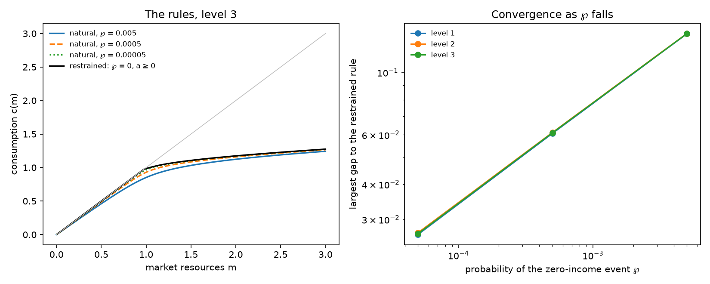

# The restrained-limit suite: the comparison

From the results files in `results`, levels 1, 2, 3. The gap is the restrained rule's consumption less the natural member's, at the suite's common points in m.

## The largest gap to the restrained rule

| ℘ | level 1 | level 2 | level 3 | where, at the top level |
|---|---|---|---|---|
| 0.005 | 0.1373 | 0.1376 | 0.1374 | m = 0.975 |
| 0.0005 | 0.06066 | 0.06114 | 0.06096 | m = 0.975 |
| 0.00005 | 0.0265 | 0.02687 | 0.02667 | m = 0.975 |

At the top level the gap falls by a factor of 2.254 and 2.286 for each tenfold fall in ℘.

## The rules at the top level

| m | restrained c | c, ℘ = 0.005 | c, ℘ = 0.0005 | c, ℘ = 0.00005 | restrained MPC | MPC, ℘ = 0.005 | MPC, ℘ = 0.0005 | MPC, ℘ = 0.00005 |
|---|---|---|---|---|---|---|---|---|
| 0.01 | 0.01 | 0.009321 | 0.009785 | 0.009931 | 1 | 0.932 | 0.9785 | 0.9931 |
| 0.02 | 0.02 | 0.01864 | 0.01957 | 0.01986 | 1 | 0.932 | 0.9785 | 0.9931 |
| 0.05 | 0.05 | 0.0466 | 0.04892 | 0.04966 | 1 | 0.9318 | 0.9784 | 0.9931 |
| 0.1 | 0.1 | 0.09317 | 0.09784 | 0.09931 | 1 | 0.9309 | 0.9781 | 0.9931 |
| 0.2 | 0.2 | 0.1861 | 0.1956 | 0.1986 | 1 | 0.9272 | 0.9772 | 0.9928 |
| 0.3 | 0.3 | 0.2786 | 0.2932 | 0.2978 | 1 | 0.9208 | 0.9749 | 0.992 |
| 0.4 | 0.4 | 0.3702 | 0.3906 | 0.397 | 1 | 0.9111 | 0.9714 | 0.9907 |
| 0.5 | 0.5 | 0.4606 | 0.4875 | 0.496 | 1 | 0.8954 | 0.9664 | 0.989 |
| 0.6 | 0.6 | 0.5491 | 0.5836 | 0.5948 | 1 | 0.8715 | 0.9572 | 0.9867 |
| 0.7 | 0.7 | 0.6346 | 0.6785 | 0.6931 | 1 | 0.8358 | 0.9406 | 0.9801 |
| 0.8 | 0.8 | 0.7153 | 0.7709 | 0.7905 | 1 | 0.7738 | 0.9004 | 0.9643 |
| 0.85 | 0.85 | 0.7531 | 0.8153 | 0.8384 | 1 | 0.7331 | 0.8666 | 0.9493 |
| 0.9 | 0.9 | 0.7887 | 0.8574 | 0.8851 | 1 | 0.6849 | 0.8105 | 0.9079 |
| 0.92 | 0.92 | 0.8023 | 0.8734 | 0.9031 | 1 | 0.6639 | 0.7797 | 0.8821 |
| 0.94 | 0.94 | 0.8154 | 0.8887 | 0.9204 | 1 | 0.6476 | 0.7536 | 0.8505 |
| 0.95 | 0.95 | 0.8218 | 0.8961 | 0.9287 | 1 | 0.6362 | 0.7334 | 0.823 |
| 0.96 | 0.96 | 0.828 | 0.9033 | 0.9367 | 1 | 0.6191 | 0.7019 | 0.773 |
| 0.97 | 0.97 | 0.8342 | 0.9103 | 0.9443 | 1 | 0.6074 | 0.6799 | 0.7344 |
| 0.975 | 0.9747 | 0.8372 | 0.9137 | 0.948 | 0.4177 | 0.6014 | 0.6691 | 0.7116 |
| 0.98 | 0.9767 | 0.8402 | 0.917 | 0.9515 | 0.4114 | 0.5957 | 0.6567 | 0.6894 |
| 0.985 | 0.9788 | 0.8432 | 0.9203 | 0.955 | 0.4095 | 0.5898 | 0.6456 | 0.6647 |
| 0.99 | 0.9808 | 0.8462 | 0.9235 | 0.9583 | 0.4065 | 0.5838 | 0.6334 | 0.6413 |
| 1 | 0.9849 | 0.852 | 0.9298 | 0.9646 | 0.399 | 0.5719 | 0.6095 | 0.5937 |
| 1.02 | 0.9927 | 0.8632 | 0.9417 | 0.9758 | 0.3831 | 0.5488 | 0.5618 | 0.5092 |
| 1.05 | 1.004 | 0.8793 | 0.9577 | 0.9899 | 0.3586 | 0.514 | 0.4956 | 0.4234 |
| 1.1 | 1.021 | 0.9037 | 0.9803 | 1.009 | 0.3161 | 0.4599 | 0.4078 | 0.3463 |
| 1.2 | 1.049 | 0.9452 | 1.016 | 1.039 | 0.2455 | 0.3706 | 0.3021 | 0.2637 |
| 1.3 | 1.071 | 0.9791 | 1.043 | 1.063 | 0.2021 | 0.307 | 0.2435 | 0.2153 |
| 1.5 | 1.107 | 1.032 | 1.085 | 1.101 | 0.1599 | 0.23 | 0.1829 | 0.1664 |
| 1.75 | 1.143 | 1.083 | 1.125 | 1.139 | 0.1329 | 0.1794 | 0.1467 | 0.1366 |
| 2 | 1.174 | 1.124 | 1.159 | 1.17 | 0.1173 | 0.1497 | 0.1266 | 0.1197 |
| 2.5 | 1.228 | 1.189 | 1.217 | 1.225 | 0.09946 | 0.1165 | 0.1043 | 0.1007 |
| 3 | 1.275 | 1.243 | 1.266 | 1.273 | 0.08926 | 0.09971 | 0.09233 | 0.09006 |
| 4 | 1.358 | 1.333 | 1.351 | 1.356 | 0.07768 | 0.08298 | 0.0792 | 0.07808 |
| 5 | 1.432 | 1.412 | 1.426 | 1.43 | 0.07102 | 0.07434 | 0.07205 | 0.0713 |
| 7 | 1.566 | 1.55 | 1.561 | 1.565 | 0.06354 | 0.06518 | 0.06407 | 0.06368 |
| 10 | 1.747 | 1.735 | 1.743 | 1.746 | 0.05772 | 0.05862 | 0.05799 | 0.0578 |
| 20 | 2.279 | 2.272 | 2.277 | 2.279 | 0.05024 | 0.05049 | 0.05032 | 0.05026 |
| 50 | 3.682 | 3.678 | 3.681 | 3.682 | 0.04467 | 0.04472 | 0.04469 | 0.04468 |

## The stationary population at the top level

| member | mass at the constraint | fraction with a ≤ 0 | mean MPC | share of a held by the bottom 10% |
|---|---|---|---|---|
| `bst-p-zero-0.005` | 0 | 0 | 0.2701 | 0.05157 |
| `bst-p-zero-0.0005` | 0 | 0 | 0.3595 | 0.03233 |
| `bst-p-zero-0.00005` | 0 | 0 | 0.4228 | 0.01448 |
| `bst-restrained` | 0.2127 | 0.2127 | 0.4556 | -6.101e-17 |
