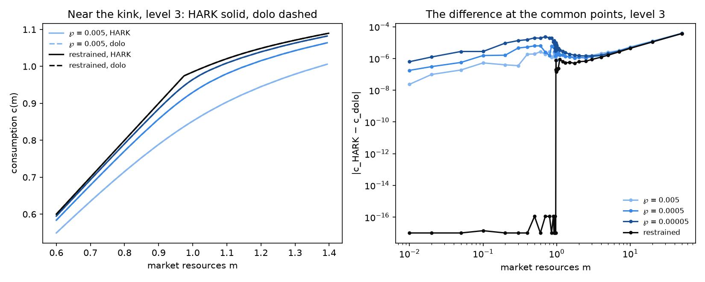

# The restrained-limit suite: HARK against dolo

From the results files in `2026-11-01_restrained-limit-suite-hark/results` (HARK) and `2026-11-01_restrained-limit-suite-dolo/results` (dolo), levels 1, 2, 3, at the suite's common points in m. Both toolkits' adapters solve the same effective member on the same nodes and savings grid at each level.

## The largest difference between the rules, |c_HARK − c_dolo|

| member | level 1, m ≤ 20 | level 2, m ≤ 20 | level 3, m ≤ 20 | level 1, all | level 2, all | level 3, all |
|---|---|---|---|---|---|---|
| ℘ = 0.005 | 0.000165 | 4.78e-05 | 1.24e-05 | 0.000452 | 0.000148 | 3.87e-05 |
| ℘ = 0.0005 | 0.000152 | 4.47e-05 | 1.15e-05 | 0.000441 | 0.000144 | 3.77e-05 |
| ℘ = 0.00005 | 0.000326 | 7.64e-05 | 2.38e-05 | 0.000438 | 0.000143 | 3.74e-05 |
| restrained | 0.000146 | 4.32e-05 | 1.1e-05 | 0.000436 | 0.000142 | 3.72e-05 |

## The largest difference between the MPCs at the common points

| member | level 1 | level 2 | level 3 |
|---|---|---|---|
| ℘ = 0.005 | 0.00656 | 0.00346 | 0.00321 |
| ℘ = 0.0005 | 0.0133 | 0.00692 | 0.00623 |
| ℘ = 0.00005 | 0.0227 | 0.0126 | 0.0124 |
| restrained | 0.00271 | 0.0032 | 0.00436 |

## The restrained rule's kink at level 3

| | m | slope below | slope above |
|---|---|---|---|
| HARK | 0.974405 | 1.0000 | 0.4185 |
| dolo | 0.974402 | 1.0000 | 0.4206 |

## The stationary population at level 3

| member | mean MPC, HARK | mean MPC, dolo | mass at a = 0, HARK | mass at a = 0, dolo | mean a, HARK | mean a, dolo |
|---|---|---|---|---|---|---|
| ℘ = 0.005 | 0.27011 | 0.27011 | 0.00000 | 0.00000 | 0.42239 | 0.42240 |
| ℘ = 0.0005 | 0.35952 | 0.35952 | 0.00000 | 0.00000 | 0.18676 | 0.18677 |
| ℘ = 0.00005 | 0.42284 | 0.42284 | 0.00000 | 0.00000 | 0.11184 | 0.11186 |
| restrained | 0.45559 | 0.45559 | 0.21274 | 0.21273 | 0.07907 | 0.07907 |

## Each toolkit's convergence to the restrained rule

The largest gap between a natural rule and the restrained one, at the common points:

| ℘ | HARK, level 1 | dolo, level 1 | HARK, level 2 | dolo, level 2 | HARK, level 3 | dolo, level 3 |
|---|---|---|---|---|---|---|
| 0.005 | 0.1373 | 0.1373 | 0.1376 | 0.1376 | 0.1374 | 0.1374 |
| 0.0005 | 0.0606 | 0.0607 | 0.0611 | 0.0611 | 0.0610 | 0.0610 |
| 0.00005 | 0.0264 | 0.0265 | 0.0268 | 0.0269 | 0.0267 | 0.0267 |

HARK at level 3: the gap falls by 2.254 and 2.286 for each tenfold fall in ℘.

dolo at level 3: the gap falls by 2.254 and 2.286 for each tenfold fall in ℘.
