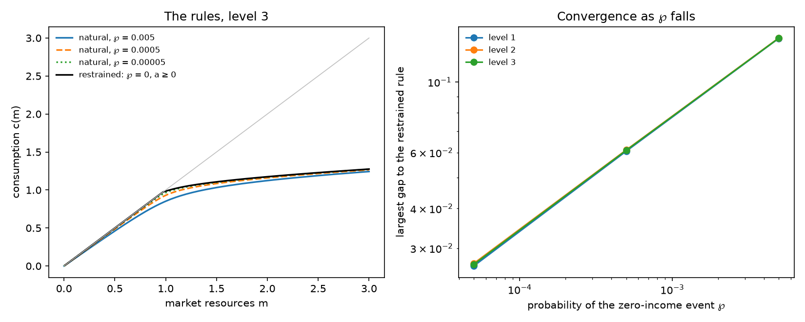

# The restrained-limit suite: the comparison

From the results files in `results`, levels 1, 2, 3. The gap is the restrained rule's consumption less the natural member's, at the suite's common points in m.

## The largest gap to the restrained rule

| ℘ | level 1 | level 2 | level 3 | where, at the top level |
|---|---|---|---|---|
| 0.005 | 0.1373 | 0.1376 | 0.1374 | m = 0.975 |
| 0.0005 | 0.0606 | 0.06113 | 0.06096 | m = 0.975 |
| 0.00005 | 0.02636 | 0.02685 | 0.02666 | m = 0.975 |

At the top level the gap falls by a factor of 2.254 and 2.286 for each tenfold fall in ℘.

## The rules at the top level

| m | restrained c | c, ℘ = 0.005 | c, ℘ = 0.0005 | c, ℘ = 0.00005 | restrained MPC | MPC, ℘ = 0.005 | MPC, ℘ = 0.0005 | MPC, ℘ = 0.00005 |
|---|---|---|---|---|---|---|---|---|
| 0.01 | 0.01 | 0.009321 | 0.009785 | 0.009932 | 1 | 0.9321 | 0.9785 | 0.9932 |
| 0.02 | 0.02 | 0.01864 | 0.01957 | 0.01986 | 1 | 0.932 | 0.9785 | 0.9932 |
| 0.05 | 0.05 | 0.0466 | 0.04892 | 0.04966 | 1 | 0.9318 | 0.9784 | 0.9932 |
| 0.1 | 0.1 | 0.09317 | 0.09784 | 0.09932 | 1 | 0.9309 | 0.9782 | 0.9931 |
| 0.2 | 0.2 | 0.1861 | 0.1956 | 0.1986 | 1 | 0.9275 | 0.9771 | 0.9927 |
| 0.3 | 0.3 | 0.2786 | 0.2932 | 0.2979 | 1 | 0.9212 | 0.975 | 0.9921 |
| 0.4 | 0.4 | 0.3702 | 0.3906 | 0.397 | 1 | 0.9112 | 0.9716 | 0.991 |
| 0.5 | 0.5 | 0.4606 | 0.4875 | 0.496 | 1 | 0.8958 | 0.9661 | 0.9892 |
| 0.6 | 0.6 | 0.5491 | 0.5836 | 0.5948 | 1 | 0.8719 | 0.9567 | 0.9861 |
| 0.7 | 0.7 | 0.6346 | 0.6785 | 0.6932 | 1 | 0.8345 | 0.9393 | 0.9801 |
| 0.8 | 0.8 | 0.7153 | 0.7709 | 0.7906 | 1 | 0.7756 | 0.9029 | 0.9654 |
| 0.85 | 0.85 | 0.7531 | 0.8153 | 0.8385 | 1 | 0.7355 | 0.8687 | 0.9485 |
| 0.9 | 0.9 | 0.7887 | 0.8574 | 0.8851 | 1 | 0.6877 | 0.8139 | 0.9116 |
| 0.92 | 0.92 | 0.8023 | 0.8734 | 0.9031 | 1 | 0.6666 | 0.7839 | 0.8843 |
| 0.94 | 0.94 | 0.8154 | 0.8888 | 0.9204 | 1 | 0.6446 | 0.7485 | 0.8435 |
| 0.95 | 0.95 | 0.8218 | 0.8961 | 0.9287 | 1 | 0.6333 | 0.7288 | 0.8161 |
| 0.96 | 0.96 | 0.828 | 0.9033 | 0.9367 | 1 | 0.6218 | 0.7079 | 0.7831 |
| 0.97 | 0.97 | 0.8342 | 0.9103 | 0.9443 | 1 | 0.6103 | 0.6859 | 0.7444 |
| 0.975 | 0.9747 | 0.8372 | 0.9137 | 0.948 | 0.4184 | 0.6044 | 0.6745 | 0.723 |
| 0.98 | 0.9767 | 0.8402 | 0.917 | 0.9515 | 0.4158 | 0.5986 | 0.6629 | 0.7005 |
| 0.985 | 0.9788 | 0.8432 | 0.9203 | 0.955 | 0.41 | 0.5927 | 0.6512 | 0.6771 |
| 0.99 | 0.9808 | 0.8462 | 0.9235 | 0.9583 | 0.409 | 0.5868 | 0.6394 | 0.6532 |
| 1 | 0.9849 | 0.852 | 0.9298 | 0.9646 | 0.4 | 0.5751 | 0.6154 | 0.6054 |
| 1.02 | 0.9927 | 0.8632 | 0.9417 | 0.9758 | 0.3854 | 0.5516 | 0.5677 | 0.5189 |
| 1.05 | 1.004 | 0.8793 | 0.9577 | 0.9899 | 0.3608 | 0.5169 | 0.5009 | 0.4289 |
| 1.1 | 1.021 | 0.9037 | 0.9803 | 1.009 | 0.3182 | 0.4624 | 0.4116 | 0.3491 |
| 1.2 | 1.049 | 0.9452 | 1.016 | 1.039 | 0.2465 | 0.3725 | 0.3039 | 0.2652 |
| 1.3 | 1.071 | 0.9791 | 1.043 | 1.063 | 0.2028 | 0.3083 | 0.2447 | 0.2161 |
| 1.5 | 1.107 | 1.032 | 1.085 | 1.101 | 0.1602 | 0.2307 | 0.1834 | 0.1669 |
| 1.75 | 1.143 | 1.083 | 1.125 | 1.139 | 0.1331 | 0.1798 | 0.1469 | 0.1368 |
| 2 | 1.174 | 1.124 | 1.159 | 1.17 | 0.1174 | 0.1499 | 0.1267 | 0.1199 |
| 2.5 | 1.228 | 1.189 | 1.217 | 1.225 | 0.09952 | 0.1166 | 0.1044 | 0.1008 |
| 3 | 1.275 | 1.243 | 1.266 | 1.273 | 0.08928 | 0.0998 | 0.09234 | 0.09009 |
| 4 | 1.358 | 1.333 | 1.351 | 1.356 | 0.07766 | 0.083 | 0.07924 | 0.07808 |
| 5 | 1.432 | 1.412 | 1.426 | 1.43 | 0.07104 | 0.07435 | 0.07203 | 0.0713 |
| 7 | 1.566 | 1.55 | 1.561 | 1.565 | 0.06353 | 0.06523 | 0.06404 | 0.06367 |
| 10 | 1.747 | 1.735 | 1.743 | 1.746 | 0.05773 | 0.0586 | 0.05799 | 0.0578 |
| 20 | 2.279 | 2.272 | 2.277 | 2.279 | 0.05027 | 0.05051 | 0.05034 | 0.05029 |
| 50 | 3.682 | 3.678 | 3.681 | 3.682 | 0.04468 | 0.04473 | 0.0447 | 0.04469 |

## The stationary population at the top level

| member | mass at the constraint | fraction with a ≤ 0 | mean MPC | share of a held by the bottom 10% |
|---|---|---|---|---|
| `bst-p-zero-0.005` | 0 | 0 | 0.2701 | 0.05157 |
| `bst-p-zero-0.0005` | 0 | 0 | 0.3595 | 0.03232 |
| `bst-p-zero-0.00005` | 0 | 0 | 0.4228 | 0.01447 |
| `bst-restrained` | 0.2127 | 0.2127 | 0.4556 | 0 |
